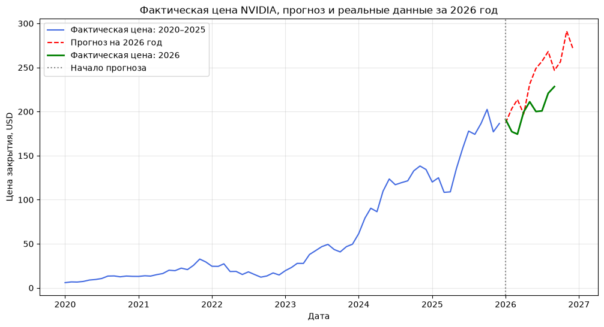

# Количественные методы анализа: временной ряд NVIDIA

Практическая работа по курсу майнора НИУ ВШЭ «Инвестиционный портфель: количественные методы анализа и управления». В работе исследуется месячная динамика цены акций NVIDIA (NVDA) и строится прогноз с сезонной компонентой.

## Итоговая визуализация

На графике сопоставлены цена закрытия за 2020–2025 годы, прогноз на 2026 год и фактические данные за доступную часть 2026 года.

## Данные и ход работы

- Источник котировок: Yahoo Finance, тикер `NVDA`
- Период исходного ряда: январь 2020 — декабрь 2025
- Частота: месячная
- Основной показатель: цена закрытия (`Close`); также рассматриваются `Open`, `High`, `Low` и `Volume`

В ноутбуке последовательно выполнены пункты практической работы:

**1. Анализ исходных данных** 
&nbsp;&nbsp;Убедимся в наличии тренда и проверим его критерием Кендалла 
&nbsp;&nbsp;1.2.1 Теперь проверяем гипотезу о линейности тренда 
&nbsp;&nbsp;1.2.2 Попробуем построить нелинейный тренд 
&nbsp;&nbsp;1.3. Проверка наличия сезонной компоненты. Составление автокорреляционной функции 
&nbsp;&nbsp;1.4. Проверка гипотезы о наличии аномальных наблюдений 
&nbsp;&nbsp;1.5. Проверка гипотезы о стационарности временного ряда 

**2. Расчёт сезонной компоненты и оценка трендовой составляющей по мультипликативной модели** 
&nbsp;&nbsp;2.1 Расчет сезонной компоненты 
&nbsp;&nbsp;2.2. Определение тренда 
&nbsp;&nbsp;2.3. Определение качества модели и расчёт ошибок 
&nbsp;&nbsp;2.4. Проверка адекватности и качества построенной модели тренда 
&nbsp;&nbsp;&nbsp;&nbsp;2.4.1. Проверка математического ожидания ряда остатков 
&nbsp;&nbsp;&nbsp;&nbsp;2.4.2. Проверка случайности ряда остатков методом серий 
&nbsp;&nbsp;&nbsp;&nbsp;2.4.3. Проверка независимости значений ряда остатков методом Дарбина—Уотсона 
&nbsp;&nbsp;&nbsp;&nbsp;2.4.4. Проверка гипотезы о нормальном распределении остатков 
&nbsp;&nbsp;&nbsp;&nbsp;2.4.5. Проверка гипотезы о постоянстве дисперсии остатков 

**3. Расчёт ошибок и оценка точности модели** по показателям MAD, MAPE, MSE и MPE 

**4. Прогноз на шестой год** и сравнение с фактическими данными за доступные месяцы 2026 года

Основной файл с расчётами и пояснениями: [`time_series_analysis.ipynb`](time_series_analysis.ipynb).

## Результат

Модель помогает описать общую динамику и сезонную структуру ряда, но не предназначена для точного предсказания котировок. На проверочном периоде 2026 года ошибка прогноза заметна, поэтому прогноз следует рассматривать как учебную оценку, а не инвестиционную рекомендацию.
